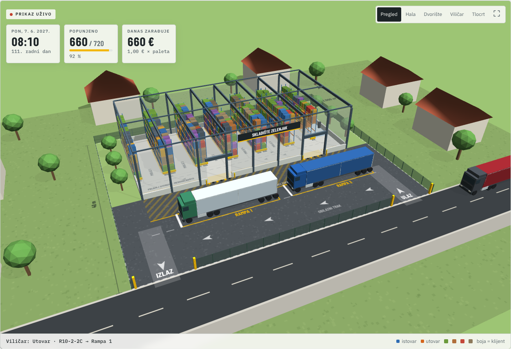

# Skladište Zelenjak

Interaktivna 3D simulacija paletnog skladišta na Zelenjaku (Zeleni brijeg, Sisak). Prikazuje parcelu od 2.000 m² s halom od 800 m², šlepere koji dolaze na istovar i utovar u dogovorenim terminima, viličar koji slaže palete po regalima i zaradu koja raste s popunjenošću. Napravljena u Babylon.js i TypeScriptu, po uzoru na [Checkout Lab](https://github.com/klindic/automated-cashiers).



## Objavljena simulacija

[Otvori simulaciju na GitHub Pages](https://klindic.github.io/pallet-warehouse/).

Svaki push na `main` pokreće testove, produkcijski build i objavu kroz GitHub Actions. U postavkama repozitorija pod **Settings → Pages** izvor mora biti **GitHub Actions**.

## Što se vidi

- **Parcela 50 × 40 m.** Hala 40 × 20 m na sjevernom dijelu, a ispred nje asfaltirano dvorište 50 × 18 m. Šleperi ulaze s istočnih vrata i izlaze na zapadna, pa se nigdje ne okreću i ne voze unatrag. Uz halu su dvije rampe za bočni istovar (šleperi s ceradom) i obilazni trak, tako da šleper može doći do rampe 1 i dok je rampa 2 zauzeta.
- **Hala.** 12 redova regala × 5 polja × 3 EUR palete × 4 razine = **720 paletnih mjesta**. Između redova je 6 prolaza po 3,8 m za protuteži viličar. Svi prolazi izlaze u hodnik uz zonu prijema i otpreme, gdje je 30 podnih mjesta za međuskladište. U istočnom pojasu su ured s WC-om i punjač viličara.
- **Razmještaj robe.** Roba koja kratko ostaje ide bliže vratima i na niže razine. Roba koja ostaje dugo ide dublje i više. Palete iste pošiljke drže se u istom prolazu.
- **Okolica.** Obiteljske kuće oko parcele podsjećaju da je Zeleni brijeg pretežito stambeni kvart. O tome ovisi smije li se ovdje uopće graditi skladište.

Kamera ima pet pogleda: pregled, hala, dvorište, viličar i tlocrt. Povlačenjem se okreće, a kotačić ili dva prsta približavaju.

## Kako teče dan

1. U **06:30** dispečer (mi) slaže raspored: prvo odvoze robe kojoj je istekao dogovoreni rok, zatim nove dovoze. Zahtjev za dovoz odbija se ako za njega nema mjesta ili ako viličar ne bi stigao odraditi posao u radnom vremenu.
2. Šleperi stižu oko dogovorenog termina, a dio njih kasni 25–75 minuta. Čekaju na ulici dok se ne oslobodi rampa.
3. Na rampi otvaraju ceradu (4 min). Zatim viličar istovaruje ili utovaruje paletu po paletu, a na kraju ide zatvaranje i papiri (3 min).
4. Viličar vozi stvarnim putem: kroz pojas ispred hale, kroz vrata, hodnikom, pa u prolaz do mjesta. Na mjestu se okreće prema regalu i diže vilice do razine. Prosječni ciklus je oko 70 s po paleti.
5. Potražnja raste po S-krivulji: na početku je oko 0,5 šlepera za istovar dnevno, a nakon oko 120 radnih dana oko 4,2.

Radi se 8 h dnevno, od ponedjeljka do petka. Noći i vikendi se preskaču.

## Zarada

Svake ponoći naplaćuje se **broj paleta na skladištu × cijena po paleti po danu** (zadano 1 €), i to za svaki kalendarski dan, pa i vikendom. Po želji se dodaje i naknada za manipulaciju po paleti na ulazu i izlazu. Mjesečni troškovi (zadano 12.000 €: rata kredita, plaće za tri ortaka, struja i leasing viličara) raspoređuju se po danima.

Ploča **Zarada** prikazuje današnji prihod, prihod ovog mjeseca, ukupni prihod i ono što ostane nakon troškova. Tu je i projekcija iz zadnjih 30 dana i dan od kojeg je prihod pokrio troškove. **CSV po danima** izvozi sve dnevne brojke.

Uz zadane postavke posao se razvija ovako: u prvom mjesecu skladište je oko 12 % puno, nakon 3–4 mjeseca 85–95 %. Na punom skladištu prihod je oko 19–21 tisuću € mjesečno. Viličar je tada zauzet oko 40 % radnog vremena, pa je usko grlo broj mjesta, a ne viličar.

## Pretpostavke i pojednostavljenja

- Sve brojke su procjene koje se mijenjaju u postavkama. Ništa nije kalibrirano mjerenjima.
- Šleper nosi do 32 EUR palete, dvije poprijeko. Viličar ih uzima sa strane jednu po jednu, kao da su sve dohvatljive.
- Rampe su prizemne, za bočni istovar. Rampe s vratima u razini poda prikolice nisu modelirane.
- Klijenti su izmišljeni i označeni slovima A–H po vrsti robe.
- Ovo nije projekt hale. Visinu, statiku, protupožarne uvjete, 20 % zelenila iz GUP-a i priključke mora riješiti ovlašteni projektant.

## Pokretanje

Potreban je Node.js 22+.

```sh
npm ci
npm run dev -- --host 127.0.0.1
```

```sh
npm test -- --run
npm run build
npm run build:pages   # isti build kao na GitHub Pages (/pallet-warehouse/)
```

## Struktura

- `src/simulation/`: čista simulacijska jezgra bez prikaza (`engine.ts`), tlocrt i mjere (`layout.ts`), konfiguracija, generator slučajnih brojeva i testovi.
- `src/scene/`: Babylon scena, tlocrt nacrtan kao tekstura tla, modeli šlepera i viličara.
- `src/main.ts`, `src/ui.ts`, `src/analytics.ts`, `src/styles.css`: hrvatsko sučelje, ploče, grafovi i CSV.

Isti seed i iste postavke uvijek daju isti tijek posla, neovisno o brzini prikaza.
